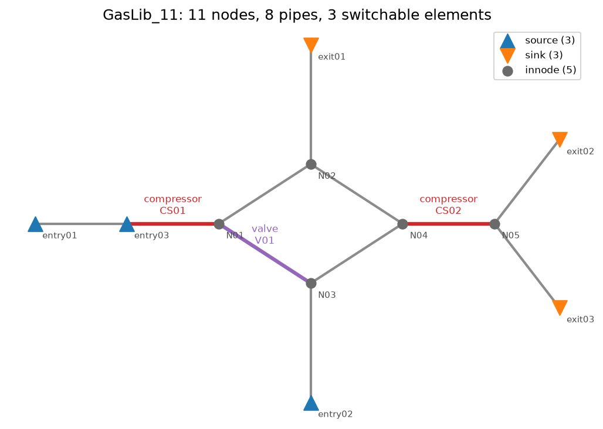
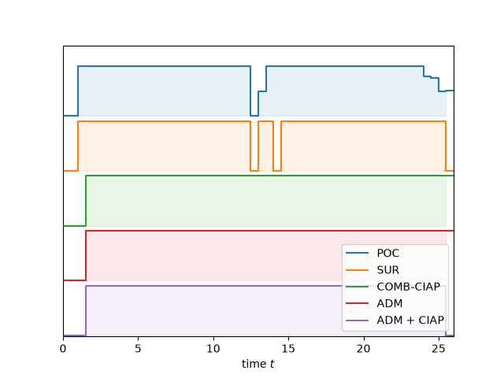
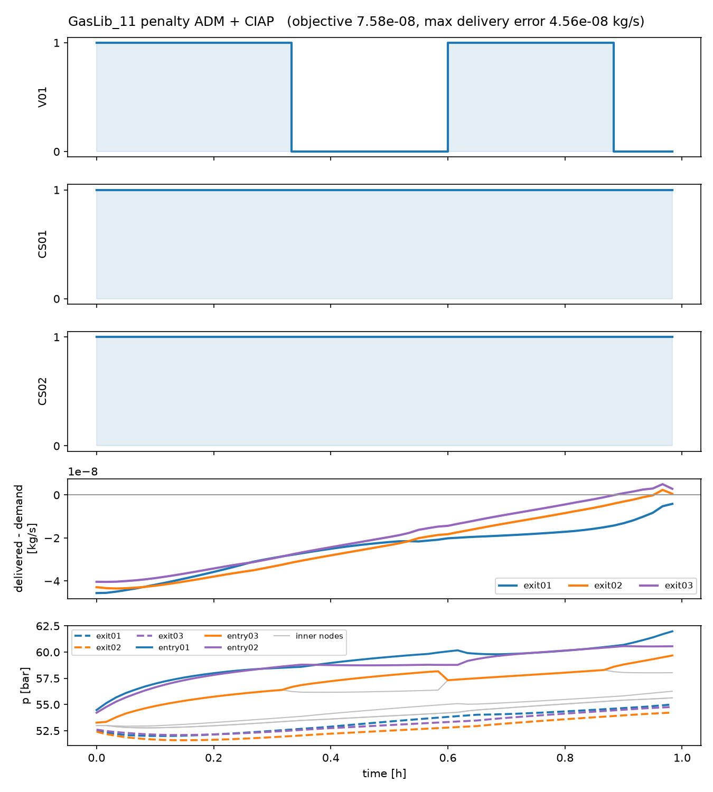

# gasnetopt — mixed-integer optimal control of energy networks

[](https://github.com/KeWu5678/gas-network-optimization/actions/workflows/ci.yml)

In a hyperbolic PDE network (gas network, 
electricity network), controls (valves, compressor stations, transmission lines) are
switched on/off over time — and every switch must not be activated too frequently, 
otherwise the network suffers from **chattering**. 
The proposed algorithm minimizes the chattering while preserving optimality. 

## The problem class

Minimize demand-tracking error over a horizon subject to **the gas networks** (semilinear isothermal Euler equations) on
  [GasLib](https://gaslib.zib.de) instances with
  [TRR154 transient data](https://www.trr154.fau.de/transient-data/).




## Method: relax → round → repair, coordinated by a penalty ADM
1. **Partial outer convexification (POC)** replaces the binary choice among
   the 2^s network configurations by convex multipliers α(t) with an SOS1
   constraint — a smooth NLP (CasADi/IPOPT). Its solution is fractional
   and serves as the reference the binary methods are measured against;
   the NLP is nonconvex, so the IPOPT solution is local and certifies no
   global bound (on the gas instance the ADM in fact finds a better local
   solution than the relaxation's).
2. **Combinatorial integral approximation (CIAP)** rounds α to a binary
   schedule: Sum-Up Rounding (fast, chatters), an exact MILP, or the
   dwell-time-constrained MILP (`COMB`).
3. **Penalty alternating direction method (ADM)** [2] alternates between
   the NLP (continuous side) and a small projection MILP (`tCOMB`,
   combinatorial side), coupled by an exact L1 penalty with increasing
   weight ρ — returning a binary, dwell-time-feasible schedule with
   reoptimized continuous controls.

Two robustness measures beyond the paper:

- the ρ **homotopy is auto-scaled** to the model's objective magnitude
  (ρ_crit = Ψ_POC/(T·n_switches)); a fixed schedule can silently lock the
  iteration onto its initial reference when objective scales differ by
  orders of magnitude between models;
- the combinatorial reference is **initialized from the data** (projection
  of the rounded POC schedule), not from an arbitrary constant
  configuration.

| layer | tool |
|---|---|
| NLP (POC relaxation, reoptimization) | CasADi + IPOPT, sparse AD |
| MILP (CIAP, COMB, tCOMB) | solver-agnostic layer: HiGHS (default, via `scipy.optimize.milp`) or Gurobi (`gasnetopt[gurobi]`, warm starts) |
| model interface | typed `OCModel` — algorithms interact with any model only through `create_solver` / `solve` / `bounds` / `parameters` / `extract` / `evaluate_objective` / `constraint_violation` / grid `t` / encoding `r`; IPOPT behind one adapter (`nlp.py`: return status, wall time, exceptions) |

## Results

### Transmission lines (benchmark of [2], extended-tree, coarse grid)

| method | objective | switching events | dwell-feasible |
|---|---|---|---|
| POC relaxation | 14.964 | - | no |
| Sum-Up Rounding + reoptimization | 15.257 | 31 | no |
| COMB-CIAP (dwell-time MILP) + reoptimization | 15.137 | 10 | yes |
| penalty ADM | 15.082 | 6 | yes |
| penalty ADM + CIAP | **15.077** | 9 | yes |

(regenerate with `uv run gasnetopt table results/translines_coarse`)

SUR chatters — 31 switches, infeasible for any real dwell requirement. The
ADM variants deliver the best objectives **and** dwell-feasibility, within
0.8 % of the locally solved relaxation:



### Transient gas network (GasLib-11, TRR154 sinus scenario, 1 h, τ_min = 900 s)

The penalty ADM turns the fractional POC relaxation (local solution,
objective 1.1·10⁻⁵) into a binary, dwell-feasible schedule at objective
7.6·10⁻⁸ with a delivery error below 10⁻⁷ kg/s and all pressures within
the 40–70 bar bounds — in under a minute end-to-end on open-source
solvers (IPOPT + HiGHS). Sum-Up Rounding tracks the demand only by
chattering: **113 switching events** across the three elements (each on
50–57 % of the time) against the ADM's **3** — 97 % fewer switching
actions at ~80× lower objective. The ADM keeps both compressors running
and switches only the valve:



(The short block at the very end of the horizon is the end-of-horizon
convention: a terminal block is exempt from the min-up check, as in
real-world transient gas control models.) Measured performance caveat:
on the finer 2 h grid (Δt = 60 s, 960 binaries per projection MILP) the
tCOMB solves exceed 1.5 h total on HiGHS — that grid needs the Gurobi
backend (`backend = "gurobi"` under `[milp]` in the config) or an
`[adm] time_budget`.


## Repository layout

```
configs/             one TOML file per experiment (see Quickstart)
data/
  translines/        demand profiles (tracked)
  gaslib/            GasLib-11/-40 + TRR154 .bcd/.state (local, see Data)
src/gasnetopt/
  cli.py             the `gasnetopt` command: run, present, table, topology
  experiment.py      config -> application -> methods -> results/<config name>/
  core/              shared layer, knows no application
    ocmodel.py       OCModel: the interface both models implement
    pipeline.py      POC, then the requested methods; method labels and
                     the results table
    adm.py           POC, rounding + reoptimization, penalty ADM, tCOMB,
                     time-budget fallback
    ciap.py          sum-up rounding, CIAP-MILP, dwell-time COMB
    nlp.py           CasADi/IPOPT boundary: NLP builder, solver adapter
    milp.py          solver-agnostic MILP layer (HiGHS/Gurobi, time limits)
  config.py          strict TOML loader + the sections all experiments share
  results_io.py      results.pkl next to the config of a run
  gas/               transient gas networks (GasLib / TRR154)
    data.py          .net/.bcd/.state parsers + validation
    model.py         ISO2 gas NLP, GasOCModel
    experiment.py    experiment schema, model build, report and figures
    plotting.py      solution and network figures
  translines/        telegraph-equation benchmark, same four modules
```

## Quickstart

Requires [uv](https://docs.astral.sh/uv/):

```sh
uv sync                      # locked environment (casadi/ipopt, numpy, scipy)
uv sync --extra gurobi       # same, plus the optional Gurobi MILP backend
                             # (a plain `uv sync` uninstalls it again)

# transmission lines benchmark (runs from the repo alone)
uv run gasnetopt run configs/translines_coarse.toml
uv run gasnetopt present results/translines_coarse     # figures
uv run gasnetopt table results/translines_coarse       # markdown table

# gas network (needs GasLib data, see Data below)
uv run gasnetopt run configs/gaslib11_1h.toml
uv run gasnetopt topology configs/gaslib11_1h.toml     # network drawing
```

An experiment is one TOML file in `configs/`: the application, the methods
to run after the POC relaxation, and all settings (grid, dwell time,
tolerances, MILP backend). `run configs/<name>.toml` writes
`results/<name>/` with a copy of the config, `results.pkl`, `run.log` and
the figures; `present` and `table` read that directory, and running its
saved `config.toml` repeats the run in place. To change a setting, edit or
copy the file.

Or via Docker (same locked environment):

```sh
docker build -t gasnetopt .
docker run --rm -v "$PWD/results:/app/results" gasnetopt \
    uv run gasnetopt run configs/translines_coarse.toml
```

## Data

The transmission-lines demand profiles ship with the repository. GasLib
networks (CC-BY 3.0) and TRR154 transient data are **not redistributed**:
download [GasLib-11](https://gaslib.zib.de) and the matching
[TRR154 `.bcd`](https://www.trr154.fau.de/transient-data/) into
`data/gaslib/GasLib-11/` (paths in `configs/gaslib11_1h.toml`).


## References

1. S. Göttlich, A. Potschka, C. Teuber: *A partial outer convexification
   approach to control transmission lines*, Comput. Optim. Appl. (2019).
2. S. Göttlich, F. M. Hante, A. Potschka, L. Schewe: *Penalty alternating
   direction methods for mixed-integer optimal control with combinatorial
   constraints*, Math. Program. 188 (2021) 599–619.
3. P. Domschke, B. Hiller, J. Lang, C. Tischendorf: *Modellierung von
   Gasnetzwerken: Eine Übersicht*, TRR154 preprint 2717 (2017).

## License & credits

GPL-3.0-or-later. The transmission-lines core is based on code
Copyright 2018 A. Potschka, C. Teuber (GPL-3.0-or-later); the gas-network
extension, the solver-agnostic MILP layer, the ADM robustness measures and
the engineering around them are this repository's contribution. GasLib
data: CC-BY 3.0 (cite Schmidt et al., *GasLib — A Library of Gas Network
Instances*, Data 2(4):40, 2017).
